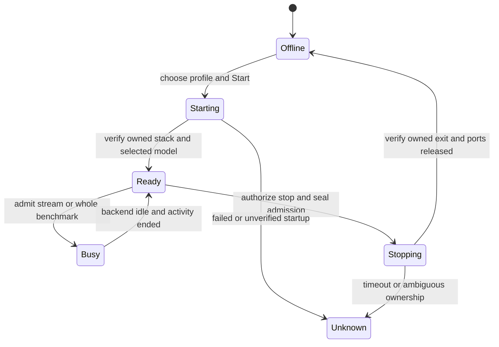

# Watson Local terminal lifecycle

The terminal is a view of the isolated stack, not the owner of its process tree. The legacy Watson/Hermes route and DSH's saved default are separate. The chosen design keeps Rich and the current Windows Job supervision; it does not add another inference scheduler or frontend runtime.

## Decisions

- **Stop Stack refuses active work**; it is not a queued command. No changes are made when that refusal is returned. Active work includes a stream whose client disconnected when its backend is still computing and the gaps between requests in a benchmark run.
- The user can start from an offline terminal, or attach to the verified owned stack already running. The normal model switch changes residency, not the whole stack. Quit detaches the terminal; it is not Stack Stop.
- A successful planned stop requires an idle verified stack and sealed admission before terminating its owned process tree. Lost acknowledgment is not proof of failure and a stopped label requires observing the owned processes and listeners gone. Abrupt loss of the supervisor is handled separately from an ordinary stop.
- The benchmark module uses only a bounded local workload. Its metrics separate evaluated input, generated output, prefill, decode, and TTFT. Context allocation and startup memory estimate are not measured prompt capacity or a fit result. Benchmarks explicitly reserve admission for the full experiment.
- The UAH [deployment adapter seam](watson-local-harness-adapter.md) remains separate; a serving alias still is not a UAH agent identity.

## Prototype evidence

The throwaway prototype is captured locally on branch `prototype/watson-local-lifecycle`, commit `bd438d6`. It has no real processes or persistence. The exercised sequence started an owned stack, refused stop during a stream, refused it again after client disconnect before backend idle, sealed idle admission, refused an overlapping new request, verified offline with the terminal intact, restarted, then refused stop during a benchmark and detached without stopping. This validated the transition model, not Windows process behavior.
